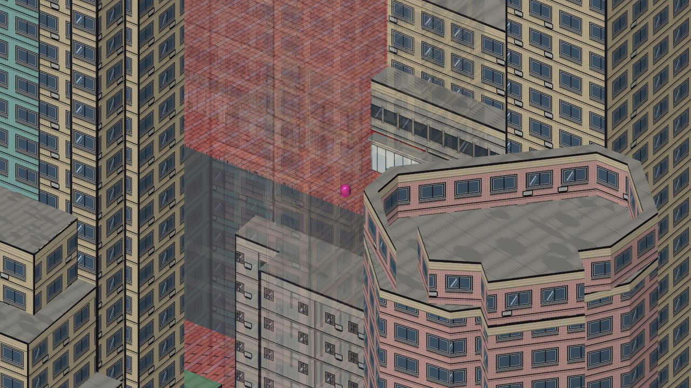
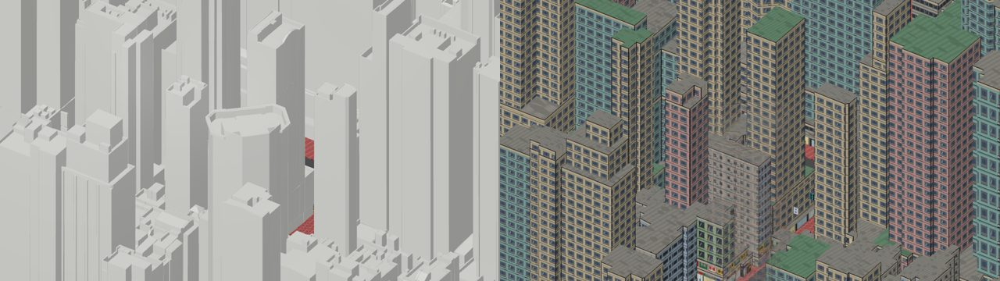
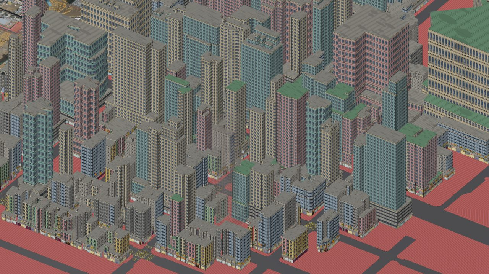
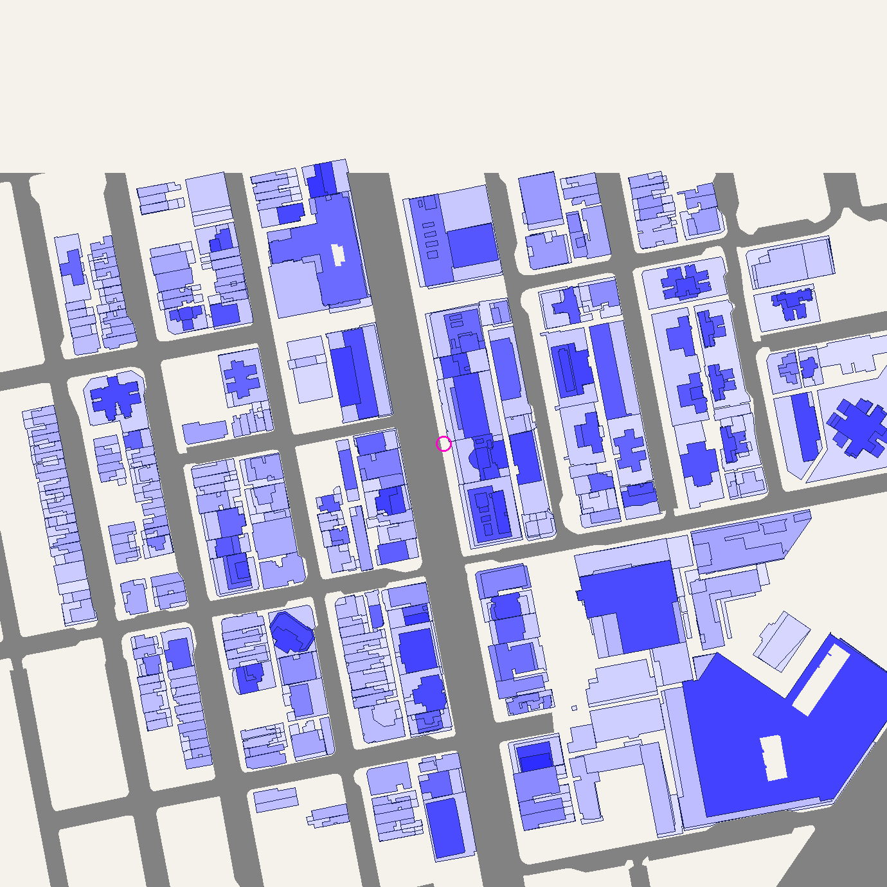

# 地圖大廈（11-NW-19D）

遊戲入面嘅大廈用**地政總署 3D 空間數據**嘅真實位置、輪廓同高度，再套**港漫風格**外牆，
直接併入底圖 `packages/client/public/maps/11-NW-19D.glb`（`B` 字頭 node）。
每棟 ≤1000 三角面，天台平頂、唔放任何物件（遊戲視角睇唔到）。



| 左：政府原始模型　右：遊戲版本 |
|---|
|  |

| 街角（擋住玩家嘅大廈自動淡出） | 鳥瞰 |
|---|---|
|  |  |

## 而家嘅範圍：出生點 200m 內，275 棟（343 筆政府記錄）



越深色越高；灰色 = 遊戲底圖嘅馬路；粉紅圈 = 出生點。每棟風格、高度、面數見 `out/11-NW-19D-gov/report.json`。

## 流程

```
地政總署 FBX0 zip ──extract_gov.py──▶ data/11-NW-19D_gov.json ──bake_gov.py──▶ 底圖 11-NW-19D.glb
   （70MB，唔入 repo）                （體量，196KB，入 repo）                  （+343 棟 B node）
```

```bash
pip install -r tools/buildings/requirements.txt

# 1. 由政府原始數據抽體量（只係擴大範圍或者數據更新先要做）
#    下載 3D 空間數據 FBX0（冇貼圖版）11-NW-19D.zip，解壓去 tools/buildings/source/（已 gitignore）
python tools/buildings/extract_gov.py tools/buildings/source/11-NW-19D --radius 200

# 2. 產生港漫大廈、寫入底圖（可以重複執行：會先清走舊嘅 B node）
python tools/buildings/bake_gov.py
```

改完記得 commit `data/11-NW-19D_gov.json`、`packages/client/public/maps/11-NW-19D.glb` 同 `out/11-NW-19D-gov/`。
後台 build 時 `scripts/copy-maps.mjs` 會自動將底圖複製畀地圖編輯器。
地板（行人路、馬路）由 `tools/ground` 處理，同呢度互不影響（見 `tools/ground/README.md`）；
兩邊共用 `glbio.py` 讀寫 GLB。

### extract_gov.py：真實模型 → 體量

政府模型每棟幾百至一萬幾個三角面，仲有天台水箱、樓梯屋、招牌、簷篷。抽出嚟嘅係「逐級體量」：

- **外輪廓**：所有三角面由上望落嘅聯集；補返模型裂縫（< 0.6m），刪走闊度 < 1m 嘅幼條（招牌、冷氣機、簷篷邊）
- **逐級高度**：向上嘅面按高度分組（相差 1.5m 內當同一級），每組以上嘅範圍 = 一級（平台 → 塔樓 → …），最多 4 級
- **天台物件**：比下一級高唔夠 7m、面積又細過佢 35% → 刪走；細過 15m² 嘅一級都刪走
- **合併**：兩級相差 < 2.5m，或者上一級只係細咗一圈 < 2m → 當同一級；最低一級矮過 2.5m（後院、地台）唔當大廈
- **天井**：細過 30m² 填滿

### bake_gov.py：體量 → 港漫大廈

- **拆件合併**：政府數據會將一棟大廈拆做幾筆 —— 塔樓（`…01…`）企喺平台（`…02…`）上面，塔樓嘅 ground 係平台頂。
  編號頭 11 位相同、輪廓重疊超過一半、或者疊喺另一筆上面（地面差 > 3m）嘅記錄會併做一棟：
  用絕對高度（mPD）重新分級，一個 mesh、一款外牆、淡出時成棟一齊淡。343 筆 → 275 棟，其中 62 棟係合併
- **位置**：直接用 HK1980 座標（glTF `(E, y, -N)`），同底圖馬路對齊；伸入底圖馬路嘅部分切走（再留 0.3m），出生點 2m 內留空
- **風格**（按高度同面積揀，同一棟每次一樣）：

  | 條件 | 風格 |
  |---|---|
  | < 10m | `low` |
  | 底 > 1500m² 而 < 30m | `commercial` |
  | 有平台、塔樓 < 60% 平台面積、> 40m | `podium_tower` |
  | ≥ 45m | `tower` |
  | ≤ 25m 而底 < 250m² | `tong_lau` |
  | 其他 | `composite` |

- **每面牆**：貼住隔籬（`party`）只畫露出嚟嗰截，露出 > 6m 就有窗；臨街（`street`）地舖 + 簷篷 + 直招牌；後巷（`lane`）用後巷外牆
- **面數控制**：超過 1000 就逐級減細節 —— 唔畫牆角墨線 → 簡化輪廓 1m → 每 2 層併一條 → 簡化 2m → 每 3／4 層併一條。
  而家 275 棟：最多 999、平均 359 面；13 棟高樓要併層
- **輸出**：每棟一個 `B<政府編號>` node（合併嘅用最高嗰筆嘅編號，例如 `B355201961101063C0`），全部共用一個材質、一張貼圖；
  `report.json` 嘅 `members` 列出每棟由邊幾筆記錄合併

### 底圖大廈喺遊戲同後台點運作

- 客戶端 `ChunkLoaderSystem` 見到 `B` 字頭就當大廈：有碰撞（招牌 4.6m、簷篷 3.9m 以上，唔會擋路）、擋住玩家會淡出
- 地圖編輯器用 `chunkId:B<編號>` 做 key，可以逐棟**隱藏、移動、替換**；重新 bake 唔會影響呢啲編輯（編號唔變）
- 想改某棟高度／輪廓：直接改 `data/11-NW-19D_gov.json` 再 `bake_gov.py`

## 擴大範圍之前要知

- `--radius` 越大，底圖越大：200m（275 棟）= 底圖 9.2MB；成個 11-NW-19D（938 棟）估計 ~20MB，
  **Cloudflare Pages 單一檔案上限 25MB**，再大就要拆 chunk 或者壓縮（meshopt / Draco）
- 底圖右下角（東南面）喺遊戲入面係成片馬路，嗰度嘅政府大廈會被切走，要先改底圖

## 舊試點包（已取代）

之前嘅 `11-NW-19D-pilot`（51 棟，航拍圖估嘅長方形 + 估計樓層）已經刪走。如果匯入過：
後台 →「地圖管理」→「建築資產」→ **匯入大廈包** →「已匯入嘅大廈包」→ `11-NW-19D-pilot` **移除**
（保持剔「完成後發佈快照」）。只會刪走呢個包嘅擺放同冇其他地方用嘅資產，其他編輯唔受影響。

## 自訂大廈包（政府數據冇嘅建築）

`build_buildings.py` 仍然可以由手描長方形產生獨立 GLB + `manifest.json`，經後台「匯入大廈包」擺上地圖（Firestore 資產 + `add` 覆蓋）。
`bake_gov.py` 亦用佢嘅外牆、招牌、貼圖函數。資料格式（本地街道座標，原點 = 出生點，向東偏北 10°）：

```jsonc
{ "packId": "my-pack", "mapName": "HongKong", "chunkId": "11-NW-19D",
  "terrain": "packages/client/public/maps/11-NW-19D.glb",
  "frame": { "originE": 835575.4, "originN": 819658.9, "angleDeg": 10 },
  "buildings": [
    { "id": "W09", "name": "單幢窄身住宅", "style": "tower", "source": "orthophoto",
      "parts": [ { "rect": [-53.8, -47.5, -15.0, 5.5], "floors": 16 } ] }   // [u0, u1, v0, v1]
  ] }
```

## 貼圖（`atlas/hk_comic_atlas.webp`，1024×1024）


上層外牆 14 款（唐樓、商住樓、住宅、玻璃幕牆、1/F 招牌、側牆、後巷）、地舖 6 款（老舖、茶餐廳、押/金行、大廈入口、商場、夜場）、
直招牌 16 個、天台、女兒牆。粗黑描邊 + 網點 + 斜線陰影。改咗畫法要重跑 `make_atlas.py`，再重新 `bake_gov.py`。

## 資料來源

大廈位置、輪廓、高度：香港特別行政區政府地政總署「3D 空間數據」（11-NW-19D，FBX0）。
原始 zip 唔放入 repo；`data/11-NW-19D_gov.json` 係由佢抽出嘅簡化體量。
