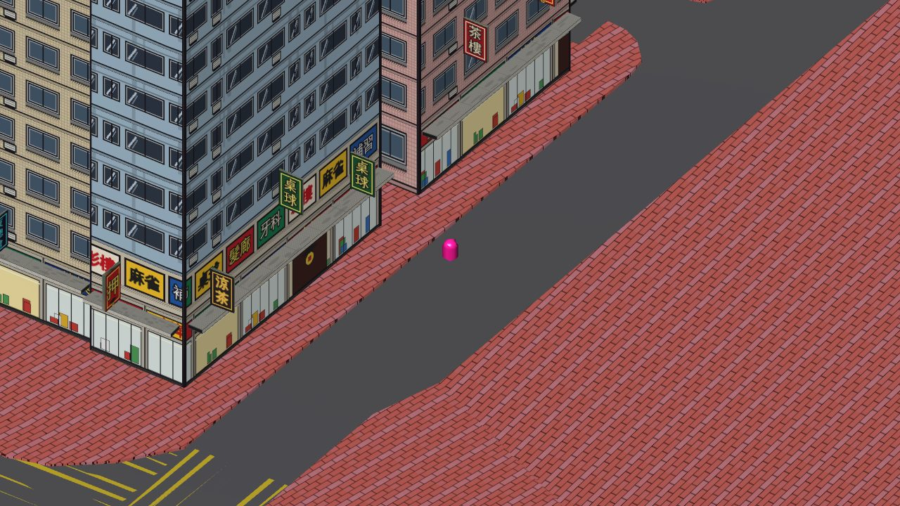
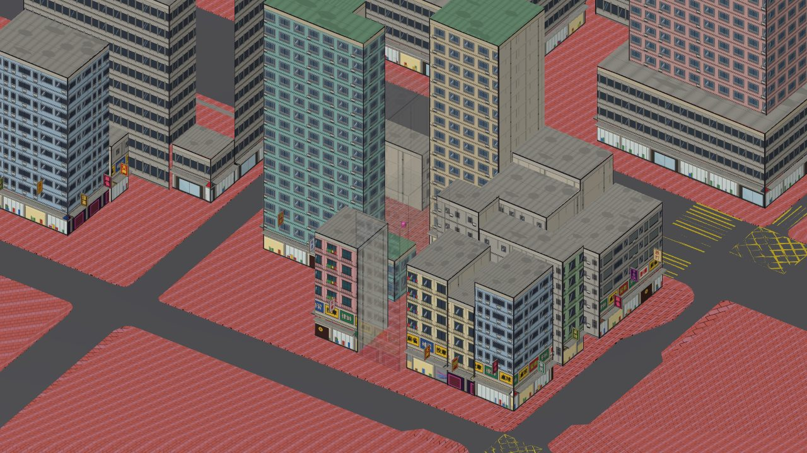
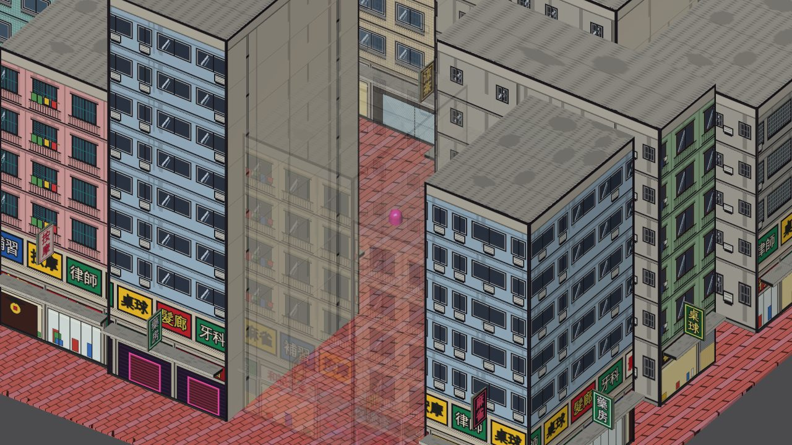
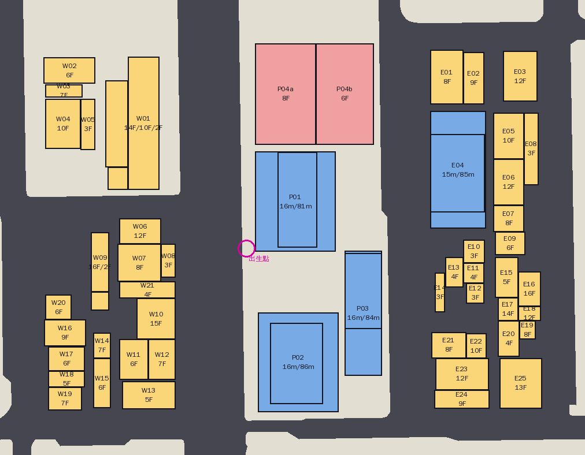
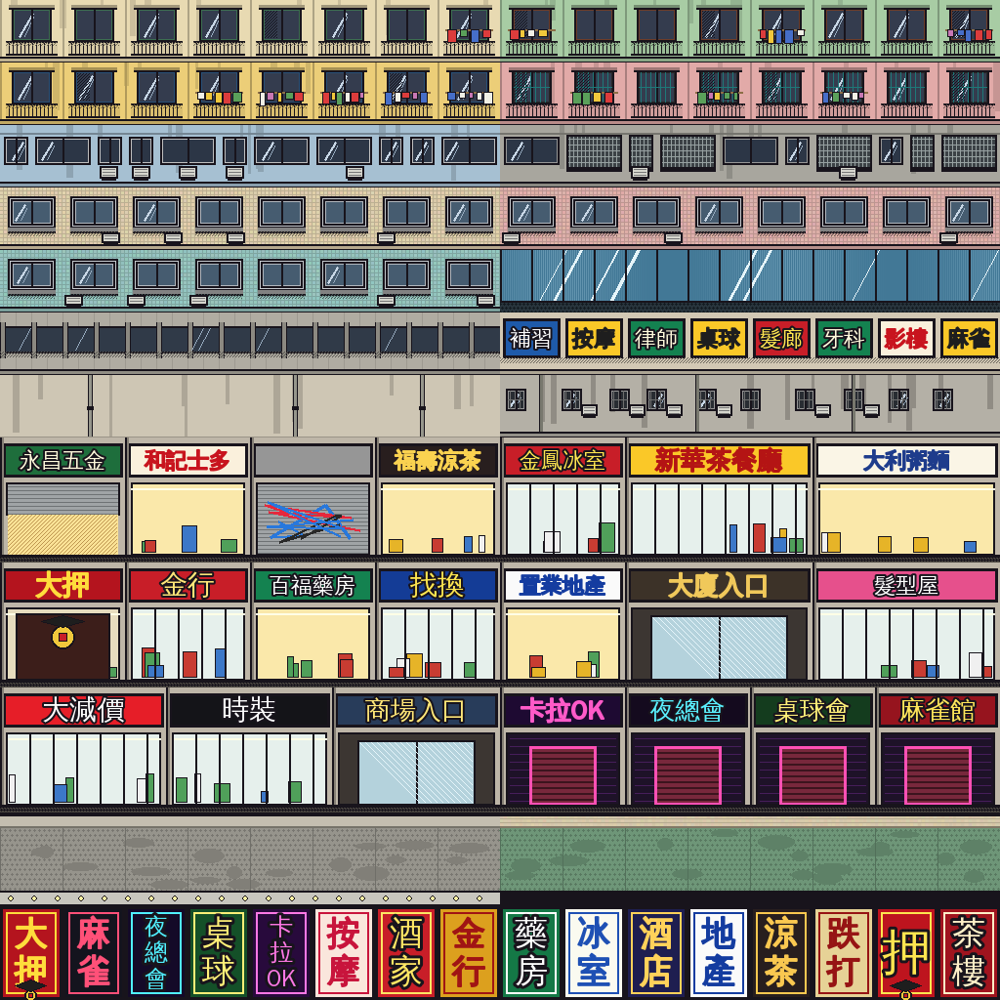

# 按實際地圖產生大廈（11-NW-19D 試點）

將真實地圖上嘅大廈變成**低面數、港漫風格**嘅 GLB，經後台「資產庫 + 覆蓋層」擺返落地圖。
每棟 ≤1000 三角面，天台唔放任何物件（遊戲視角睇唔到）。



| 鳥瞰（彌敦道西） | 後巷（擋住玩家嘅大廈自動淡出） |
|---|---|
|  |  |

## 試點範圍：出生點附近三個街段，51 棟



黃色 = 航拍圖描出、藍色 = 地政總署 3D 數據、粉紅 = 純估計；圈住嘅係伺服器出生點。

| 資料 | 來源 | 準確度 |
|---|---|---|
| 大廈輪廓（W01–W21、E01–E25） | git 歷史 `c8f001e` 舊地形貼圖入面嘅正射航拍圖（約 10cm/像素），同而家 11-NW-19D 嘅道路完全對齊 | 約 ±1m |
| P01–P03、E04 輪廓 + 高度 | 舊 GLB 入面嘅地政總署 3D 大廈模型（B355…/B356…） | 準，但數據比航拍圖舊 |
| 其他大廈樓層數 | 按天台外觀同大廈類型**估計**（航拍圖睇唔到樓高） | 要人手核對 |
| P04a / P04b | 航拍圖該位置被遮蓋（粉紅色），亦冇政府數據 | 純估計 |

> 呢個環境連唔到 Google 街景 / OpenStreetMap / 地政總署網站，所以外牆係按大廈類型套用風格，唔係逐棟對照街景。
> 想某棟更似真：改 `data/11-NW-19D_pilot.json` 嘅 `floors`、`style`，或者用 `upper` / `ground` 指定外牆款式，再重新產生。

## 安裝

```bash
pip install -r tools/buildings/requirements.txt
```

## 用法

```bash
python tools/buildings/make_atlas.py                                           # 共用貼圖（改咗畫法先要重跑）
python tools/buildings/build_buildings.py tools/buildings/data/11-NW-19D_pilot.json
```

輸出 `out/<packId>/`：

- `<id>.glb`：每棟一個。Y-up、1 單位 = 1 米、原點喺底部中心；只有一個材質（一個 draw call）
- `manifest.json`：後台匯入用（資產名稱、標籤、擺放 transform）
- `plan.png`：平面預覽

程式會印每棟三角面數，超過 1000 會直接報錯停低；亦會列出邊棟為咗留行人路（離馬路最少 2m）同出生點（3m）而縮細咗。
`DEBUG_EDGES=1` 會再印每面牆被判斷成臨街（street）、後巷（lane）定係貼住鄰居（party）。

## 放上地圖

1. 後台 →「地圖管理」→「建築資產」→ **匯入大廈包**
2. 一次過揀 `out/11-NW-19D-pilot/` 入面嘅 `manifest.json` 同全部 `.glb`
3. 保持剔「完成後發佈快照」→ 開始匯入

每棟會變成一個資產 + 一筆 `add` 覆蓋（key = `add:<packId>:<id>`）。**重新匯入同一個包唔會重複擺放**：
GLB 冇變只會更新位置；GLB 有變會上載新資產、刪走冇人用嘅舊資產。擺好之後一樣可以喺地圖編輯器逐棟移動、刪除、替換。

## 資料格式（`data/*.json`）

座標用**本地街道座標** `(u, v)`：原點 = 出生點 (E835575.4, N819658.9，HK1980 Grid)，
u 沿街道網格向東（真北偏 10°）、v 向北，單位米。咁樣大廈輪廓同街道平行，用長方形就描到。

```jsonc
{ "id": "W09", "name": "單幢窄身住宅", "style": "tower", "source": "orthophoto",
  "parts": [
    { "rect": [-53.8, -47.5, -15.0, 5.5], "floors": 16 },     // [u0, u1, v0, v1]
    { "rect": [-53.8, -47.5, -21.4, -15.0], "floors": 2 }
  ] }
```

- `floors`：層數（地舖 4.5m + 每層 3–3.6m + 1m 女兒牆）；或者用 `height`（米，連女兒牆）
- `base`：喺平台上面嘅塔樓用，例如 `{ "rect": [...], "base": 15.5, "height": 81 }`
- `style`：`tong_lau`（唐樓）、`composite`（商住樓）、`tower`（住宅大廈）、`commercial`（商業）、`podium_tower`（平台 + 塔樓）、`low`（低層）
- 可選 `upper` / `ground`：指定外牆 / 地舖款式（見 `atlas/atlas_layout.json` 嘅區域名，例如 `TL_green`、`SHOP_night`）

## 貼圖（`atlas/hk_comic_atlas.webp`，1024×1024）



上層外牆 14 款（唐樓、商住樓、住宅、玻璃幕牆、1/F 招牌、側牆、後巷）、地舖 6 款（老舖、茶餐廳、押/金行、大廈入口、商場、夜場）、
直招牌 16 個、天台、女兒牆。粗黑描邊 + 網點 + 斜線陰影。

## 遊戲系統嘅配合（`COL_` 碰撞方塊、共用貼圖）

- **`COL_` 開頭嘅 mesh = 隱形碰撞方塊**：客戶端用佢做碰撞，唔渲染、唔參與遮擋；編輯器同縮圖都唔顯示。
  招牌同簷篷凸出行人路，用成個模型外框做碰撞會擋住行人路，所以每個落地部分另外出一個方塊
- **碰撞方塊跟埋旋轉**：以前擺放資產用世界座標嘅軸對齊外框，呢度街道斜 10°，方塊會大一圈擋住行人路
- **貼圖名 `shared:hk_comic_atlas:<hash>`**：每個 GLB 都嵌住同一張 atlas（GLB 自成一體，Blender 開得返），
  客戶端同編輯器見到同名貼圖只保留一份 GPU 貼圖（51 棟實測 = 1 份）
- **遮擋淡出**：正交相機會畫埋相機後面嘅嘢，以前遮擋射線由相機位置開始，40m 以上嘅大廈遮住玩家都唔會淡出；
  而家射線由視線後方 250m 開始

## 擴展到成個 11-NW-19D 之前要諗嘅嘢

試點 51 棟 GLB 合共約 6MB（大部分係每個 GLB 各自嵌住嘅 atlas，約 110KB），全部存入 Firestore。
成張地圖估計有幾百棟，每位玩家入地圖要下載幾十 MB、讀幾百個 Firestore 文件。到時建議二揀一：

1. **貼圖改用外部檔案**（GLB 只剩幾十 KB）：客戶端同編輯器載入資產時要畀 `rootUrl`
2. **直接併入底圖 GLB**（`B` 字頭節點）：靜態檔由 Cloudflare 免費供應，唔使 Firestore，地圖編輯器照樣可以改
