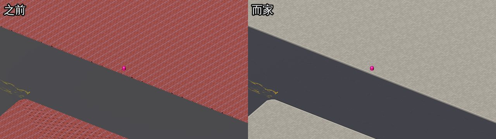
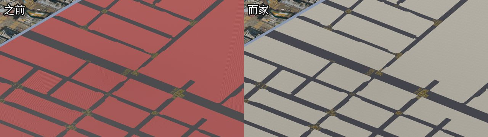
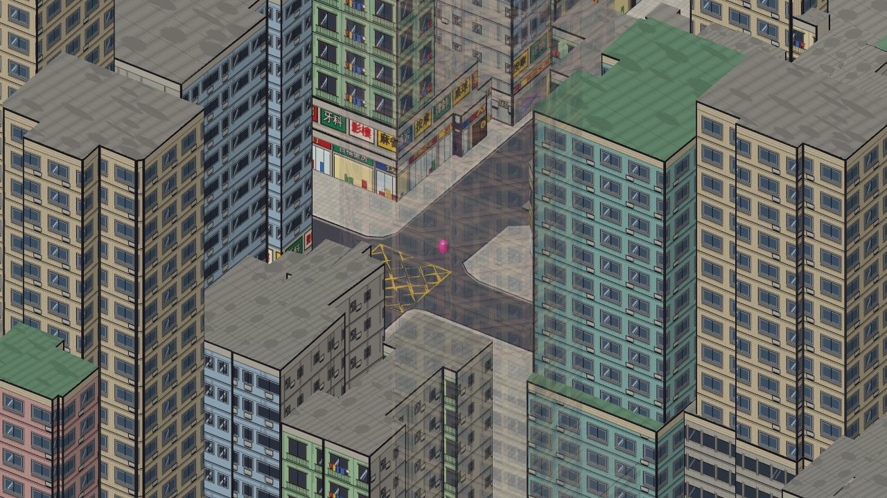

# 地板（11-NW-19D）

底圖 `packages/client/public/maps/11-NW-19D.glb` 嘅地形（`T19Dmap`）換成港漫風格：
港式方階磚行人路、路邊石 + 墨線、瀝青馬路、啞光黃線。





| 加埋大廈 |
|---|
|  |

## 用法

```bash
python tools/ground/make_ground_textures.py   # 改咗貼圖畫法先要重跑 → textures/
python tools/ground/restyle_ground.py         # 改底圖地形（可以重複執行）
```

同 `tools/buildings/bake_gov.py`（大廈）互不影響：兩個都只會改自己嗰部分（`T` node / `B` node），先後次序冇所謂。

## 之前有咩問題

| | 之前 | 而家 |
|---|---|---|
| 行人路 | 紅磚貼圖用原本 UV 鋪 360 次；node 有不等比縮放 → 磚拉長；磚縫粗黑，遠睇出斜紋（摩爾紋）；開咗清漆反光 | 港式 50cm 方階磚，按真實米數鋪、跟街道方向（偏 10°）；啞光 |
| 路邊 | 兩塊重疊嘅板（頂 0.05m 同 0.2m），邊位兩級、睇唔清 | 一塊板，頂 0.2m；貼住馬路嘅邊有 10cm 墨線 + 30cm 淺灰路邊石 |
| 馬路 | 平色深灰 | 瀝青（雜點、裂紋），按米數鋪 |
| 黃線 | 同馬路一樣高，會閃 | 抬高 1.5cm、港式黃色、啞光 |
| 檔案 | 紅磚 PNG 1MB | 兩張 WebP 合共約 95KB |

行人路面高度同以前一樣係 0.2m，玩家（跨步 0.35m）照樣由馬路行得上行人路。

## 貼圖（`textures/`）

| 檔案 | 代表 | 內容 |
|---|---|---|
| `pavement.webp`（512px） | 6m × 6m | 12 × 12 塊 50cm 方階磚；每塊深淺少少唔同，幾塊有網點、水漬、香口膠漬、裂紋 |
| `asphalt.webp`（1024px） | 12m × 12m | 深藍灰瀝青、雜點、墨線裂紋 |

按遊戲鏡頭距離（約 20–25 像素／米）設計：磚縫 3px，遠睇睇到格仔但唔會出斜紋。
馬路刻意唔畫補丁同大片陰影，因為每 12m 就重複一次，一格格好易睇得出。

## 未做

- 馬路白色行車線、斑馬線（要知道每條路嘅中線，底圖冇呢啲資料）
- 隔籬 chunk `11-NW-19B` 仲係用航拍相做地板，風格唔一致
